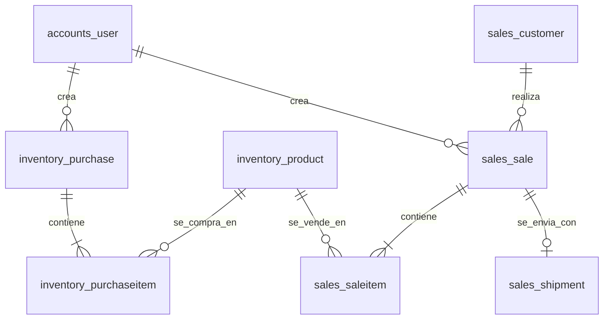

# DATA_MODEL — MercyVentas

## a) Diagrama

## b) Columnas base (BaseModel abstracto en apps/core; NO hay deleted_at: se usa status `cancelled` y PROTECT)

| Columna | Tipo | Parámetros | Para investigar |
|---|---|---|---|
| id | BIGINT | PK, GENERATED BY DEFAULT AS IDENTITY | BigAutoField, DEFAULT_AUTO_FIELD, identity columns |
| created_at | TIMESTAMPTZ | NOT NULL, DEFAULT now() | auto_now_add, db_default, Now(), USE_TZ |
| updated_at | TIMESTAMPTZ | NOT NULL, DEFAULT now() | auto_now, db_default, update_fields |

Todas las tablas heredan estas 3 columnas excepto `accounts_user` (usa las de AbstractUser). No hay columnas reservadas.

## c) Tablas

### accounts_user
Admins del sistema. `AbstractUser` personalizado (clase vacía en v1), definido antes de la primera migración.

| Columna | Tipo | Parámetros | Para investigar |
|---|---|---|---|
| id | BIGINT | PK, IDENTITY | AbstractUser, AUTH_USER_MODEL |
| username | VARCHAR(150) | NOT NULL, UNIQUE | UnicodeUsernameValidator |
| password | VARCHAR(128) | NOT NULL | PASSWORD_HASHERS, set_password, check_password |
| first_name, last_name, email | VARCHAR(150), VARCHAR(150), VARCHAR(254) | NOT NULL, DEFAULT '' | blank vs null en CharField |
| is_active, is_staff, is_superuser | BOOLEAN | NOT NULL | createsuperuser, ModelAdmin |
| last_login | TIMESTAMPTZ | NULL | update_last_login |
| date_joined | TIMESTAMPTZ | NOT NULL, DEFAULT now() | timezone.now |

### inventory_product
Producto que se compra y se vende.

| Columna | Tipo | Parámetros | Para investigar |
|---|---|---|---|
| name | VARCHAR(200) | NOT NULL; índice btree | Meta.indexes, models.Index |
| sku | VARCHAR(50) | NOT NULL, UNIQUE | unique=True, índice único |
| sale_price | NUMERIC(12,2) | NOT NULL, CHECK (>= 0) | DecimalField(max_digits, decimal_places), CheckConstraint, Q |
| last_unit_cost | NUMERIC(12,2) | NULL, CHECK (>= 0) | último costo de compra, copia vs referencia |
| stock | INTEGER | NOT NULL, DEFAULT 0, CHECK (>= 0) | PositiveIntegerField vs CHECK, F(), db_default |
| is_active | BOOLEAN | NOT NULL, DEFAULT true | borrado lógico vs flag |
| notes | TEXT | NULL | TextField |

### inventory_purchase
Pedido de compra a un proveedor.

| Columna | Tipo | Parámetros | Para investigar |
|---|---|---|---|
| platform | VARCHAR(20) | NOT NULL, CHECK IN ('temu','shein','other') | TextChoices, CheckConstraint IN |
| order_ref | VARCHAR(100) | NULL | referencia externa |
| status | VARCHAR(20) | NOT NULL, DEFAULT 'ordered', CHECK IN ('ordered','in_transit','received','cancelled'); índice | TextChoices, máquina de estados |
| ordered_at | TIMESTAMPTZ | NOT NULL, DEFAULT now(); índice | db_default, Meta.ordering |
| received_at | TIMESTAMPTZ | NULL | NULL semántico |
| shipping_cost | NUMERIC(12,2) | NOT NULL, DEFAULT 0, CHECK (>= 0) | DecimalField |
| notes | TEXT | NULL | TextField |
| created_by_id | BIGINT | NOT NULL, FK accounts_user, ON DELETE RESTRICT; índice | on_delete=PROTECT, db_on_delete (Django 6.1), settings.AUTH_USER_MODEL |
| (tabla) | — | UNIQUE (platform, order_ref) WHERE order_ref IS NOT NULL | UniqueConstraint(condition=Q(...)), índice único parcial |

### inventory_purchaseitem
Línea de una compra.

| Columna | Tipo | Parámetros | Para investigar |
|---|---|---|---|
| purchase_id | BIGINT | NOT NULL, FK inventory_purchase, ON DELETE CASCADE | on_delete=CASCADE, db_on_delete |
| product_id | BIGINT | NOT NULL, FK inventory_product, ON DELETE RESTRICT; índice | on_delete=PROTECT |
| quantity | INTEGER | NOT NULL, CHECK (> 0) | CheckConstraint |
| unit_cost | NUMERIC(12,2) | NOT NULL, CHECK (>= 0) | copia histórica (regla e) |
| (tabla) | — | UNIQUE (purchase_id, product_id) | UniqueConstraint(fields=[...]) |

### sales_customer
Cliente al que se le vende y envía.

| Columna | Tipo | Parámetros | Para investigar |
|---|---|---|---|
| full_name | VARCHAR(150) | NOT NULL; índice | Meta.indexes |
| phone | VARCHAR(30) | NULL | normalizar teléfonos |
| city | VARCHAR(100) | NULL | — |
| address | VARCHAR(255) | NULL | — |
| notes | TEXT | NULL | TextField |

### sales_sale
Venta a un cliente.

| Columna | Tipo | Parámetros | Para investigar |
|---|---|---|---|
| customer_id | BIGINT | NOT NULL, FK sales_customer, ON DELETE RESTRICT; índice | on_delete=PROTECT |
| status | VARCHAR(20) | NOT NULL, DEFAULT 'pending', CHECK IN ('pending','paid','shipped','delivered','cancelled'); índice | TextChoices, CheckConstraint |
| sold_at | TIMESTAMPTZ | NOT NULL, DEFAULT now(); índice DESC | índice descendente, db_default |
| payment_method | VARCHAR(20) | NOT NULL, CHECK IN ('cash','transfer','other') | TextChoices |
| total | NUMERIC(12,2) | NOT NULL, CHECK (>= 0) | copia del total (regla e), Sum, aggregate |
| notes | TEXT | NULL | TextField |
| created_by_id | BIGINT | NOT NULL, FK accounts_user, ON DELETE RESTRICT; índice | on_delete=PROTECT |

### sales_saleitem
Línea de una venta, con precio y costo del momento.

| Columna | Tipo | Parámetros | Para investigar |
|---|---|---|---|
| sale_id | BIGINT | NOT NULL, FK sales_sale, ON DELETE CASCADE | on_delete=CASCADE, db_on_delete |
| product_id | BIGINT | NOT NULL, FK inventory_product, ON DELETE RESTRICT; índice | on_delete=PROTECT |
| quantity | INTEGER | NOT NULL, CHECK (> 0) | CheckConstraint |
| unit_price | NUMERIC(12,2) | NOT NULL, CHECK (>= 0) | copia histórica (regla e) |
| unit_cost | NUMERIC(12,2) | NOT NULL, CHECK (>= 0) | copia histórica (regla e), margen |
| (tabla) | — | UNIQUE (sale_id, product_id) | UniqueConstraint(fields=[...]) |

### sales_shipment
Envío de una venta (máximo uno por venta en v1).

| Columna | Tipo | Parámetros | Para investigar |
|---|---|---|---|
| sale_id | BIGINT | NOT NULL, UNIQUE, FK sales_sale, ON DELETE CASCADE | OneToOneField |
| carrier | VARCHAR(100) | NULL | — |
| tracking_code | VARCHAR(100) | NULL | — |
| status | VARCHAR(20) | NOT NULL, DEFAULT 'preparing', CHECK IN ('preparing','in_transit','delivered','returned'); índice | TextChoices |
| shipping_cost | NUMERIC(12,2) | NOT NULL, DEFAULT 0, CHECK (>= 0) | DecimalField |
| shipped_at, delivered_at | TIMESTAMPTZ | NULL | NULL semántico |

## d) Alcance del diseño
Pensado para v1 y los próximos 6 meses con unos pocos miles de filas. Sin particiones, sin tablas de eventos.

## e) Regla de copia histórica
`purchaseitem.unit_cost`, `saleitem.unit_price`, `saleitem.unit_cost` y `sale.total` se copian al momento de la operación. Cambiar `sale_price` o `last_unit_cost` en el producto nunca altera registros pasados.
